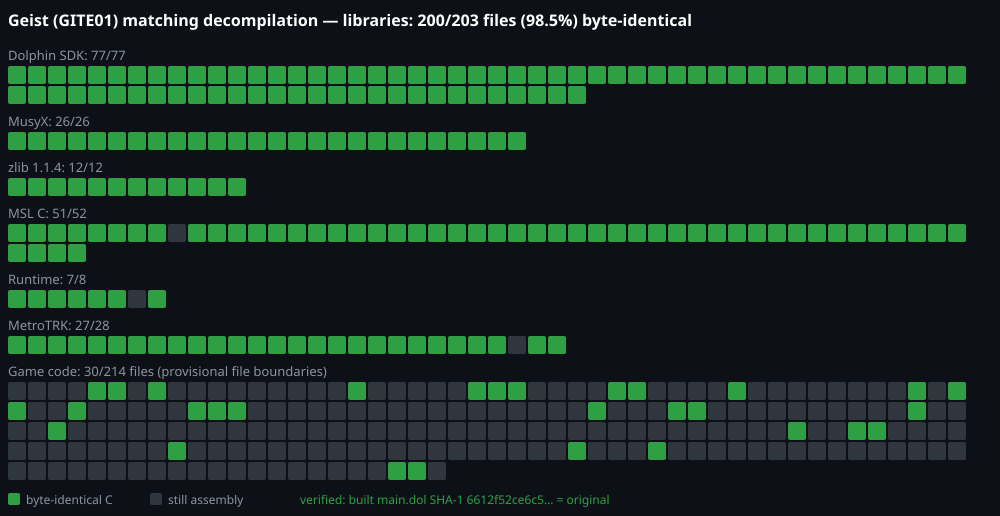

# Geist matching decompilation (GITE01)

A matching decompilation of **Geist** (GameCube, n-Space 2005, NTSC-U `GITE01` rev 0).
The goal is C/C++ source that recompiles, with the original Metrowerks CodeWarrior compiler,
into a `main.dol` that is **byte-identical** to the retail one.



Green = translation unit rebuilt from C/C++ byte-identically; orange = partly matched (C source exists and some
of its functions already compile to the original bytes; the unit still links from assembly); grey = still
assembly. Hover a square for the file name. Regenerate after a build with `python3 tools/progress_svg.py`
(run `ninja build/GITE01/report.json` first for the orange squares).

**Contributions are welcome**, from people and from AI models. You provide your own copy of the game.
Start with [CONTRIBUTING.md](CONTRIBUTING.md). To point an AI agent at the repo, see
[docs/contributing-with-ai.md](docs/contributing-with-ai.md) (what to provide, setup, and prompts to paste);
agents should also read [AGENTS.md](AGENTS.md). The work queue and what has been tried are in
[STATUS.md](STATUS.md), and the source shapes that make this compiler match are in
[docs/matching-tricks.md](docs/matching-tricks.md).

## Never distribute game data
This repository contains **no game data**. `orig/`, `build/` and all game binaries are gitignored. To build it you
need your own legally obtained copy of the game. Never commit or upload the DOL, REL, disc image, or anything
extracted from them, and never commit decompiler (Ghidra/IDA) pseudocode output.

## Setup
1. Extract `sys/main.dol` from your own copy of Geist (NTSC-U, `GITE01`) and place it at
   `orig/GITE01/sys/main.dol`. It must have SHA-1 `6612f52ce6c50bb831ffddd5264b22973304f288`.
   (`orig/GITE01/files/loader.rel`, SHA-1 `20cc25827a68208dd48e0929e901ef6a83feda42`, is not used yet.)
2. Install Python 3 and [ninja](https://ninja-build.org/). On Linux/macOS, `configure.py` downloads the rest
   into `build/`: decomp-toolkit (dtk v1.8.4), objdiff-cli, wibo (to run the Windows compilers), the
   CodeWarrior compilers and gc-wii-binutils. See [docs/getting_started.md](docs/getting_started.md) and
   [docs/dependencies.md](docs/dependencies.md) for details from the template.

## Build
```sh
python3 configure.py
ninja            # rebuilds main.dol and checks it against config/GITE01/build.sha1
```
A good build ends with `build/GITE01/main.dol: OK`.

## State
- **Libraries:** 201 of 203 units build from C and match: Dolphin SDK 77/77, MusyX 26/26, zlib 12/12,
  Runtime 8/8, MSL C 51/52, MetroTRK 27/28.
- **Game code** (CodeWarrior GC/1.3.2, C++) is split into 220 provisional units; file boundaries are corrected
  as files get matched. 68 are fully matched, each verified byte-identical in the linked DOL, and 101 more are
  partly matched (orange on the progress map): they have C source and some of their functions already compile
  to the original bytes. Across the game code, 1,751 of 7,123 functions match. STATUS.md has the per-unit queue.
- There's no symbol map on the disc, so names are descriptive guesses except for SDK/runtime functions that
  were recognised by signature. Placeholders are `fn_`/`lbl_` followed by the address.
- `loader.rel` is left out: its imports from main.dol use ELF-style section indices with absolute addresses,
  which dtk v1.8.4 rejects. It's only 10 functions and can be added later.

## Credits
- Built on [encounter/dtk-template](https://github.com/encounter/dtk-template) (CC0) and
  [decomp-toolkit](https://github.com/encounter/decomp-toolkit); template documentation is in [`docs/`](docs/).
- Dolphin SDK source in `src/dolphin/` and its headers in `include/` come from
  [doldecomp/dolsdk2004](https://github.com/doldecomp/dolsdk2004) (commit 2328b416), by TakaRikka, RevoSucks
  and the doldecomp contributors. That repository does not state a licence; all credit for that work goes to
  its authors, and they can ask for it to be removed or relicensed.
- MusyX source in `src/musyx/` is adapted from [AxioDL/musyx](https://github.com/AxioDL/musyx)
  (MIT, (c) 2023 Axiomatic Data Laboratories; commit ec4697520f70); licence in `src/musyx/LICENSE`.
- TRK_MINNOW_DOLPHIN, Runtime.PPCEABI.H and MSL_C math sources and headers are adapted from
  [zeldaret/tp](https://github.com/zeldaret/tp) (CC0; commit c8fa8c9, `libs/TRK_MINNOW_DOLPHIN`,
  `libs/PowerPC_EABI_Support`). Geist-specific edits: MetroTRK banner "v2.0", `__sys_alloc`, a new rand.c,
  time.c and time.gamecube.c.
- Parts of the MSL_C sources (string.c, FILE_POS.c, qsort.c, printf.c, ansi_fp.c, alloc.c) follow the
  PrimeDecomp/prime project (commit 4da6e0e, `extern/sdk/runtime`; no longer available at that GitHub address),
  an older MSL revision.
- `Gecko_ExceptionPPC.cp` follows the [projectPiki/pikmin2](https://github.com/projectPiki/pikmin2) decompilation's
  runtime source (CC0).
- zlib 1.1.4 in `src/zlib/` is from [madler/zlib](https://github.com/madler/zlib) tag v1.1.4 (zlib licence,
  `src/zlib/README.license`, (C) 1995-2002 Jean-loup Gailly and Mark Adler); K&R definitions converted to ANSI.
- The physics code in Geist uses the Open Dynamics Engine ([ODE](https://www.ode.org/), (C) 2001-2003
  Russell L. Smith, BSD licence); the matched solver and collision routines follow ODE's source as a reference.
- Geist is (C) n-Space / Nintendo. This project is an independent, unofficial reverse-engineering effort for
  preservation and study, and contains none of the game's data.
